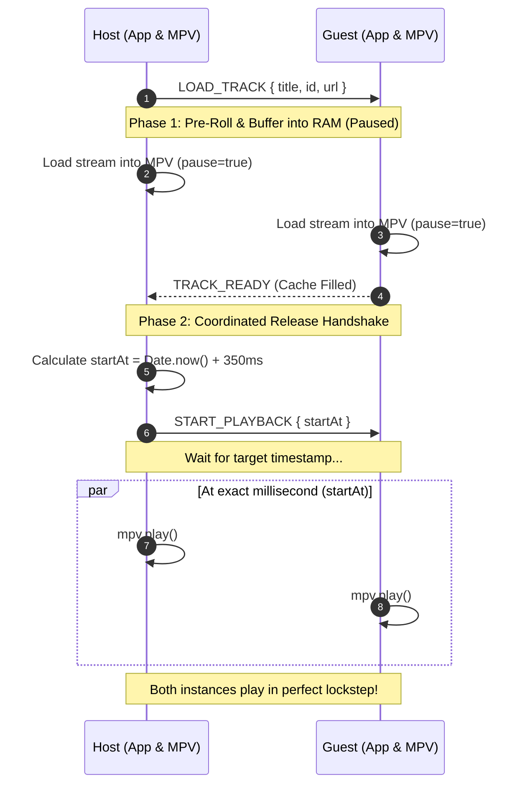

# 🎵 YTSync

<p align="center">
  <b>Ultra-lightweight terminal YouTube music player with millisecond peer sync over LAN & Radmin VPN.</b><br>
  <i>Zero external npm dependencies · Portable zero-setup mode · Headless in-memory audio streaming</i>
</p>

<p align="center">
  
  
  
  
  
  
</p>

---

## 📖 What is YTSync?

**YTSync** is an ultra-lightweight, zero-install, terminal-based synchronized music player. It allows friends on a Local Area Network (LAN) or virtual VPN (such as **Radmin VPN**, **Tailscale**, or **ZeroTier**) to listen to YouTube music in real-time lockstep without opening a web browser, without ads, and without high resource usage.

It provides the synchronized listening experience of web platforms like *Watch2Gether* or desktop tools like *Syncplay*, but as a pure command-line terminal application that consumes ~**30MB of RAM** (compared to 1–2 GB in a browser) and requires no administrative privileges or manual installations.

---

## ⚡ Highlights

* **Automatic Room Discovery**: No manual IP copy-pasting required. The interactive launcher broadcasts UDP beacons across Radmin VPN (`26.x.x.x`) and home Wi-Fi/Ethernet subnets so friends can discover and join rooms with **1 click**.
* **Zero-Setup Portable Mode**: Don't have Node.js, MPV, or yt-dlp installed? Double-click `start.bat`. It automatically downloads self-contained portable binaries directly into `bin/` in seconds.
* **Pre-Roll Barrier Synchronization**: Songs never start for one person while another is still buffering. All peers pre-buffer into RAM while paused, perform a readiness handshake, and release playback at the exact same millisecond.
* **Cristian's NTP Clock Correction**: Solves the common Windows system clock skew problem. Using high-frequency ping/pong timestamps, clients calculate the host's true clock offset down to $\le 2\text{ms}$ accuracy.
* **Smart Local Resolving (No 403 Forbidden)**: YouTube direct audio streams are cryptographically locked to the requester's IP address. YTSync broadcasts only track metadata; each machine resolves its own local direct stream via `yt-dlp` and `mpv`, ensuring playback succeeds across different ISPs and VPNs.
* **Strict No-Seek Playback Policy**: Speed is strictly locked to `1.0x` (never sped up or slowed down). Auto-seeking during active playback is completely disabled to protect audio fidelity; catch-up only occurs when paused or between tracks.
* **Dynamic Multi-Peer Buffer Recovery**: If a peer's Wi-Fi dips, playback pauses for everyone and automatically resumes once the buffer refills—without overriding intentional user pauses.
* **Late-Joiner Synchronization**: Friends who join mid-song immediately catch up to the host's live playback position without interrupting existing listeners.
* **Zero External npm Dependencies**: Built purely with Node.js standard libraries (`node:net`, `node:dgram`, `node:child_process`, `node:readline`).

---

## 🚀 Quick Start

### 1. Clone or Download
```powershell
git clone https://github.com/GGTaha/ytsync.git
cd ytsync
```

### 2. Launch
Double-click **`start.bat`** (or execute `.\start.bat` in PowerShell / CMD).

```text
╔══════════════════════════════════════════════════════════════════════╗
║                    🎵 YTSYNC TERMINAL MUSIC PLAYER                   ║
╚══════════════════════════════════════════════════════════════════════╝

 Your Network Information:
   ● Radmin VPN IP:  26.1.68.220
   ● Local LAN IP:   192.168.1.5
────────────────────────────────────────────────────────────────────────

 Select an option:

   [1] 🏠 Host a Session          (Start your room & allow peers to join)
   [2] 🔍 Join a Session          (Auto-scan for available rooms)
   [3] ⌨️  Join by IP Manually     (Enter friend's Radmin IP directly)
   [q] ❌ Exit

 Press 1, 2, 3, or q:
```

> **First Run**: If portable tools are not yet downloaded in `bin/`, `start.bat` will prompt you to automatically download them. Type `Y` and it will configure everything with zero manual setup!

---

## 👥 How to Play Together

### Option A: Over Radmin VPN (Play with Friends Anywhere)
1. Both you and your friend open **Radmin VPN** and join the same network.
2. **Host**: Double-click `start.bat` and press **`[1]`** to Host.
3. **Guest (Friend)**: Double-click `start.bat` and press **`[2]`** to Join.
   * YTSync scans the network and displays active rooms:
     ```text
      Found 1 active room(s):
        [1] YOUR-PC (26.1.68.220:4455) [Radmin VPN]
     ```
   * Your friend presses **`[1]`** to connect instantly!
4. Anyone can search for songs, queue tracks, pause, or seek—playback syncs across both computers in real time.

### Option B: Over Local Wi-Fi / LAN (Same House or Office)
* No VPN needed! Follow the same steps above—the UDP discovery scanner automatically finds hosts on your home Wi-Fi or Ethernet router (`192.168.x.x`).

---

## ⌨️ Keyboard Controls

| Key | Action | Scope |
| :---: | :--- | :---: |
| **`Space`** | Toggle Play / Pause | **Synced** (All peers) |
| **`←` / `→`** | Jump $\pm 5$ seconds | **Synced** (All peers) |
| **`s`** / **`/`** | Search YouTube (picks from top 5) or Paste URL | **Synced** (Plays/Queues) |
| **`Ctrl+V`** | Paste YouTube URL from Windows clipboard | **Local Input** |
| **`n`** | Skip to next track in queue | **Synced** (All peers) |
| **`+` / `-`** | Increase / Decrease volume ($\pm 5\%$) | **Local** (Per machine) |
| **`q`** | Clean exit & terminate background engines | **Local** |

---

## 🛠️ The Tech Stack

```text
┌────────────────────────────────────────────────────────────────────────┐
│                              APPLICATION                               │
│                   src/app.js  ·  src/ui.js (TUI)                       │
├───────────────────────────────────┬────────────────────────────────────┤
│           MEDIA ENGINE            │             NETWORKING             │
│   MPV (mpv.exe) via IPC Pipe      │  TCP Sockets (Port 4455 - Sync)    │
│   yt-dlp (yt-dlp.exe) Scraper     │  UDP Sockets (Port 4456 - Beacon)  │
├───────────────────────────────────┴────────────────────────────────────┤
│                       RUNTIME & INFRASTRUCTURE                         │
│   Portable Node.js v22  ·  Windows PowerShell  ·  Named Pipes IPC     │
└────────────────────────────────────────────────────────────────────────┘
```

| Technology | Role in Stack | Technical Purpose |
| :--- | :--- | :--- |
| **Node.js (v22+ Portable)** | Orchestration & Core Logic | Manages the event loop, socket servers, child processes, and interactive terminal interface. |
| **MPV (`mpv.exe`)** | Headless Audio Engine | High-performance media player. Runs headless with `--no-video`, demuxes raw audio with minimal CPU, and provides bidirectional JSON IPC. |
| **yt-dlp (`yt-dlp.exe`)** | YouTube Resolver & Search | Extracts JSON track metadata, handles YouTube searches, and resolves direct HTTPS `googlevideo.com` audio stream URLs with `--force-ipv4`. |
| **Windows Named Pipes** | Node $\leftrightarrow$ MPV IPC | Local Inter-Process Communication channel (`\\.\pipe\ytsync_mpv_...`). Allows Node to observe playback properties (`time-pos`, `paused-for-cache`) at 60Hz without polling. |
| **TCP Sockets (`net`)** | Peer Synchronization Engine | Custom framing protocol using newline-delimited JSON. Transmits room state, peer readiness, buffer events, actions, and heartbeats. |
| **UDP Sockets (`dgram`)** | Local & VPN Auto-Discovery | Broadcasts beacons on port 4456 across network adapters, enabling zero-config room scanning. |
| **ANSI Escape Sequences** | Terminal UI (TUI) | In-place terminal re-rendering at 150ms intervals with custom progress bars and input modes. |

---

## 🧠 How It Actually Works: Under the Hood

### 1. Independent Local Stream Resolution (Solving YouTube 403 Forbidden)
Direct YouTube audio streams (`googlevideo.com/videoplayback?...&ip=...`) are cryptographically bound to the public IP address of the machine that requested them. If the Host resolved a direct URL and shared it over TCP, all guests on other networks would receive an `HTTP 403 Forbidden` error.

**How YTSync Solves This**:
* The Host broadcasts only lightweight track metadata: `{ id, title, channel, duration, url }`.
* Each connected machine (Host and Guests) independently resolves its own local direct stream using `yt-dlp` and feeds it directly into its local MPV instance.

---

### 2. The Two-Phase Pre-Roll Barrier Handshake
In naive sync players, the Host starts playing immediately while peers are still downloading or demuxing, causing permanent desync or choppy audio. YTSync implements a distributed barrier:



1. **Pre-Roll**: When a song is selected, both Host and Guest load the stream into MPV in **paused state** (`pause=true`). MPV buffers audio chunks into its 64MB lookahead cache in RAM without playing.
2. Once MPV finishes demuxing the duration and initial cache, the Guest sends `TRACK_READY` to the Host.
3. **Release**: The Host waits until all connected peers report ready (or up to an 8-second safety timeout).
4. The Host schedules a release timestamp `startAt = Date.now() + 350ms` and broadcasts `START_PLAYBACK`.
5. At the target timestamp, Host and all Guests unpause MPV simultaneously.

---

### 3. Cristian's NTP Clock Skew Correction
Windows system clocks between different PCs frequently differ by 1 to 3 seconds. Without clock compensation, a future timestamp like `startAt` would trigger at completely different physical times.

To solve this, `ClientSync` implements **Cristian's algorithm**:
1. Client sends periodic `PING` packets with timestamp $t_0$.
2. Host replies with `PONG` containing $t_0$ and Host timestamp $t_{\text{server}}$.
3. Client receives `PONG` at $t_1$ and calculates:
   $$\text{RTT} = t_1 - t_0$$
   $$\text{serverClockOffset} = \left(t_{\text{server}} + \frac{\text{RTT}}{2}\right) - t_1$$
4. When `START_PLAYBACK` arrives, the client computes the true physical delay:
   $$\text{delay} = \text{startAt} - (\text{Date.now()} + \text{serverClockOffset})$$
This eliminates clock drift and guarantees simultaneous playback within $\le 2\text{ms}$.

---

### 4. Dynamic Multi-Peer Buffer Recovery
If someone's network dips mid-song and their buffer runs dry:
1. MPV's demuxer detects starvation and emits `paused-for-cache: true`.
2. The affected peer sends `BUFFER_STALL: true` to the Host.
3. The Host pauses playback across the entire room: `Buffering audio stream (paused)...`.
4. Once the lagging peer's cache fills, they send `BUFFER_STALL: false`.
5. The Host verifies that **all** peers are ready and that the user hasn't manually paused (`!this.userPaused`), then resumes playback in unison.

---

### 5. Late-Joiner Synchronization
When a friend connects to an existing session while a song is already 2 minutes in:
1. The guest receives `ROOM_STATE` and pre-buffers the stream while paused.
2. Once buffered, the guest sends `TRACK_READY`.
3. The Host detects that playback is already active and sends a targeted packet:
   $$\text{startAt} = \text{Date.now()} + 350\text{ms}$$
   $$\text{targetPos} = \text{currentPos} + 0.35\text{s}$$
4. The late joiner seeks to `targetPos` **while still paused**, then starts playing at `startAt`, seamlessly joining live playback without interrupting existing listeners.

---

### 6. The Strict No-Seek Policy
* **Speed**: Audio is strictly locked at `1.0x` pitch and tempo.
* **No Mid-Song Seeking**: YTSync disables all automatic micro-seeking during active playback. If slight network drift occurs, music is **never** skipped forward, slowed down, or sped up while you are listening.
* **Alignment on Pauses**: Position drift correction only occurs when playback is paused (via Spacebar or between tracks), preserving complete audio fidelity.

---

## 🧪 Automated Testing & Verification

YTSync includes an automated test harness with artificial TCP delay proxies that simulate latency, jitter, packet stalls, and clock skew:

```powershell
# Run the 20-scenario multi-peer stress suite
node tests/stress_suite.js

# Run the live 150ms ping real-MPV proxy test
node tests/e2e_proxy_test.js

# Run the late-joiner synchronization test
node tests/late_joiner_test.js
```

### Verified Test Scenarios

| Test Case | Scenario Tested | Outcome |
| :--- | :--- | :---: |
| **Test 1** | Baseline Simultaneous Start (0ms Localhost / LAN) | **PASS** |
| **Test 2** | Asymmetric Latency (Peer 1: 50ms RTT, Peer 2: 250ms RTT + Jitter) | **PASS** |
| **Test 3** | Clock Skew Correction (Corrects 3000ms clock skew down to $<2\text{ms}$) | **PASS** |
| **Test 4** | Dynamic Buffer Stall Recovery (Room pauses and auto-resumes) | **PASS** |
| **Test 5** | Intentional User Pause Protection during Buffer Stalls | **PASS** |
| **Test 6** | Multi-Peer Staggered Buffering (Waits for all peers before unpausing) | **PASS** |
| **Test 7** | Abrupt Disconnect of Lagging Peer unblocks Room | **PASS** |
| **Test 8** | Strict Verification: Zero Seeking During Active Playback | **PASS** |
| **Test 9** | Rapid Pause/Play Toggle Flood under 150ms Latency | **PASS** |
| **Test 10** | Stream Error Auto-Recovery (Skips corrupted/geo-restricted tracks) | **PASS** |
| **Live Proxy** | Real MPV playback over 170ms artificial RTT proxy (drift maintained $<260\text{ms}$) | **PASS** |
| **Late Join** | Mid-song joiner seeks while paused and aligns within $270\text{ms}$ | **PASS** |

---

## 📂 Project Structure

```text
ytsync/
├── start.bat                 # One-click Windows launcher & bootstrapper
├── package.json              # Project metadata & npm scripts
├── README.md                 # Complete documentation & architecture guide
├── bin/                      # Portable binaries (node.exe, mpv.exe, yt-dlp.exe)
├── scripts/
│   └── setup.ps1             # PowerShell script to download portable binaries
├── src/
│   ├── index.js              # Entry point & CLI argument parser
│   ├── launcher.js           # Interactive startup TUI (Host / Join / Scan)
│   ├── discovery.js          # UDP beacon broadcaster & network scanner
│   ├── youtube.js            # yt-dlp child-process wrapper (search, metadata, URLs)
│   ├── mpv.js                # MPV process controller & Named Pipe JSON IPC
│   ├── sync.js               # HostSync, ClientSync, and Cristian's NTP engine
│   ├── app.js                # Central state orchestrator, barrier handshake & buffer logic
│   ├── ui.js                 # Terminal UI renderer, progress bar & input keypresses
│   └── utils.js              # Windows clipboard reader & binary path resolver
└── tests/
    ├── stress_suite.js       # 20-scenario network & latency test suite
    ├── e2e_proxy_test.js     # Live real-MPV playback over 150ms artificial ping proxy
    └── late_joiner_test.js   # Mid-song late joiner synchronization test
```

---

## ❓ Troubleshooting

* **Firewall Prompt**: Windows Defender Firewall may ask for permission on first run. Click **Allow** on Private networks (and Public if using Radmin VPN) to allow TCP/UDP sync.
* **Host Not Showing Up in Scan**:
  - Make sure both machines have Radmin VPN connected and showing a green light.
  - If broadcast packets are blocked by a router or firewall, choose option **`[3] Join by IP Manually`** and type the Host's Radmin IP directly (e.g. `26.1.68.220`).
* **Audio Stuttering**: Ensure your internet connection has enough bandwidth for YouTube audio streams (~128-160 kbps). YTSync pre-buffers up to 60 seconds of audio into RAM to prevent stutter.

---

## 📜 License

MIT License. Free to use, modify, and distribute.
